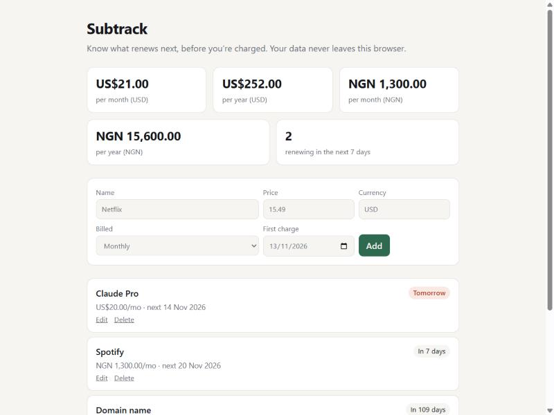

# Subtrack

**Know what renews next, before you're charged.**

A private, offline-first subscription tracker. Add your subscriptions once, see your real monthly and yearly spend, and drop reminders into any calendar app so a renewal never surprises you again.

**Live demo:** https://dudusola.github.io/subtrack/



## Features

- **Next renewal at a glance**: list sorted by what charges you next, with a red badge for anything due within 3 days.
- **True cost**: weekly, monthly and yearly plans normalised to per-month and per-year totals.
- **Multi-currency**: totals are kept per currency (USD, EUR, NGN, ...). No fake exchange rates.
- **Calendar reminders**: export an `.ics` file with recurring events and an alert 1, 3 or 7 days before each renewal. Works with Google Calendar, Apple Calendar and Outlook.
- **Private by design**: no account, no server, no tracking. Data lives in your browser's local storage.
- **Backup and restore** as JSON. Imported files are validated before they replace anything.
- **Installable PWA** that opens offline, with light and dark themes.

## Run locally

No build step and no dependencies.

```bash
python -m http.server 8000
```

Then open http://localhost:8000.

## Tests

The date and money logic lives in `core.js` and is covered with Node's built-in test runner (Node 18+):

```bash
node --test
```

Edge cases covered include month-end billing (a plan started on Jan 31 renews Feb 28, then Mar 31), leap years, and malformed backup files.

## Project layout

| File | Purpose |
| --- | --- |
| `core.js` | Pure logic: renewal dates, totals, `.ics` export, import validation |
| `app.js` | UI and local storage |
| `index.html` | Markup and styles |
| `sw.js`, `manifest.webmanifest` | Offline support and install |

## License

MIT
