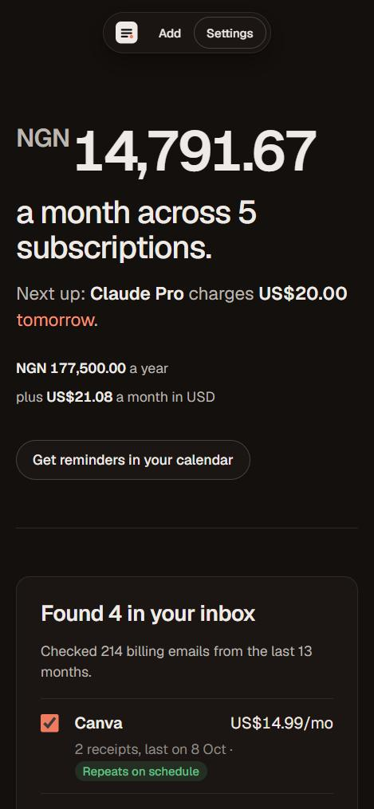
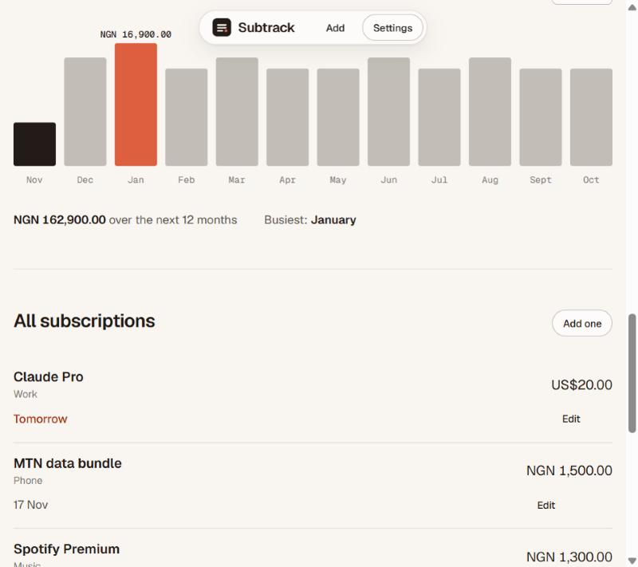

# Subtrack

**Find every subscription hiding in your inbox, see what bills you next, and get reminded before it does.**

Subtrack connects to Gmail with read-only access, reads 13 months of receipts, and works out what you subscribe to, how much it costs and when it renews. You confirm what to track. After that, a private calendar link alerts your phone before each charge.

It's a self-hosted web app with accounts, an installable PWA front end, and a Node backend with **zero npm dependencies**.


<p>
  
  
</p>

## What it does

- **Inbox scan.** Click *Scan inbox* and Subtrack searches your billing mail. It groups receipts by sender, reads the amount and currency (`$`, `₦`, `€`, `£`, `₹`, `USD 9.99`, `120.00 GBP` …), and works out the billing cycle from the gaps between charges. Each result says why it was picked: *repeats on schedule*, *says it renews*, or *guess, check it*. Anything you already track is flagged so you don't add it twice.
- **Privacy by design.** Gmail access is read-only and lasts for one scan. The Google token is never stored and is revoked as soon as the scan ends.
- **Accounts.** Each person has their own subscriptions. Passwords are hashed with scrypt, sessions use HttpOnly cookies, and sign-in attempts are rate-limited.
- **The real number first.** The dashboard opens on what you actually spend per month. Mixed currencies are kept separate, never converted with made-up exchange rates.
- **Next 30 days.** A timeline and agenda of every upcoming charge. Anything within 3 days is highlighted.
- **12-month projection.** Spend per month, with your busiest month called out.
- **Calendar reminders.** Each account gets a secret `.ics` link to subscribe to in Google Calendar, Apple Calendar or Outlook. It updates on its own, alerts 1, 3 or 7 days before each charge, and you can reset it anytime.
- **Installable.** Add it to your home screen on Android, iOS or desktop. The app shell loads offline.
- **Your data.** JSON backup and restore, plus account deletion that removes everything.

## Run it

Requires Node 22.13 or newer. There's nothing to install.

```bash
git clone https://github.com/Dudusola/subtrack.git
cd subtrack
cp .env.example .env
npm start
```

Open http://localhost:3000 and create an account.

### With Docker

```bash
docker build -t subtrack .
docker run -p 3000:3000 -v subtrack-data:/data -e BASE_URL=http://localhost:3000 subtrack
```

### Turn on the inbox scan

1. In [Google Cloud Console](https://console.cloud.google.com/), create a project and enable the **Gmail API**.
2. Set up the OAuth consent screen, then add the scope `https://www.googleapis.com/auth/gmail.readonly`.
3. Create an **OAuth client ID** of type *Web application*, with the redirect URI `<BASE_URL>/api/gmail/callback`.
4. Put the client ID and secret in `.env` as `GOOGLE_CLIENT_ID` and `GOOGLE_CLIENT_SECRET`, then restart.

While your Google app is in *Testing* mode, only the Google accounts you list as test users can scan (up to 100). Opening it to everyone means going through Google's verification for the restricted Gmail scope.

| Variable | Default | Purpose |
| --- | --- | --- |
| `BASE_URL` | `http://localhost:$PORT` | Public URL. Used for cookies, the cross-site request check, calendar links and the Google redirect |
| `PORT` | `3000` | Port to listen on |
| `DATABASE_PATH` | `subtrack.db` | SQLite file |
| `GOOGLE_CLIENT_ID` / `GOOGLE_CLIENT_SECRET` | unset | Turns on the inbox scan |

## How it's built

| File | What it does |
| --- | --- |
| `server.js` | HTTP server and JSON API, built on `node:http` and `node:sqlite`: auth, sessions, subscriptions, the scan flow and the calendar feed |
| `detect.js` | Turns receipt emails into subscription candidates: amount parsing, merchant grouping and cycle detection |
| `gmail.js` | The OAuth code flow and the Gmail search, then revokes the token |
| `public/core.js` | Date and money logic shared by server and browser: renewals, month-end clamping, projections, `.ics` |
| `public/app.js` | The front end, in plain ES modules with no build step and no framework |

Security: a strict Content-Security-Policy, JSON-only mutations plus an Origin check against cross-site request forgery, scrypt with constant-time comparison, per-user scoping on every query, single-use OAuth `state`, and path-traversal protection on static files.

## Tests

```bash
npm test
```

17 tests, using Node's built-in test runner. They cover month-end and leap-year renewals, receipt parsing and cycle detection, account isolation, cross-site request rejection, the OAuth state check, calendar link rotation and static-file traversal.

## License

[MIT](LICENSE) © 2026 Dudusola
