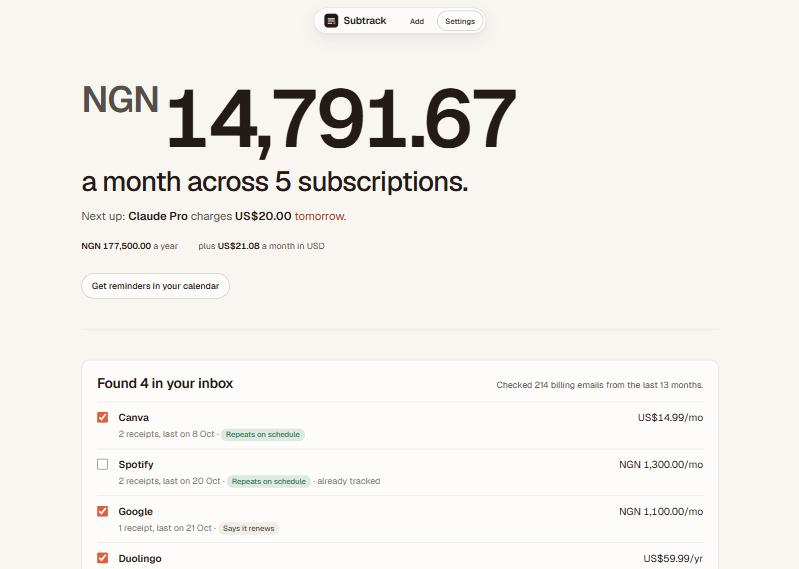
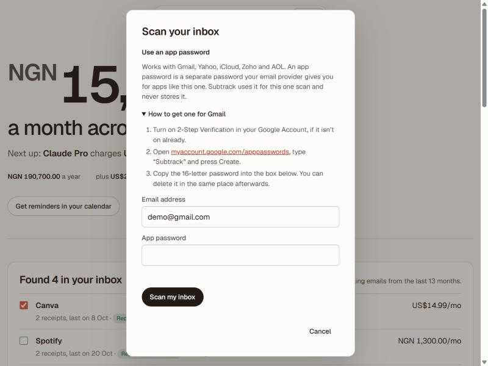

# Subtrack

[](https://github.com/Dudusola/subtrack/actions/workflows/test.yml)


**Find every subscription hiding in your inbox, see what bills you next, and get an email before it does.**

Subtrack reads your receipt emails, works out what you subscribe to, how much it costs and when it renews, and reminds you before each charge or before a free trial turns into a paid one. It's free, open source, and runs entirely on free services.



<p>
  
  
</p>

## Features

- **Inbox scan, two ways.**
  - *App password* (free, no approval needed) for Gmail, Yahoo, iCloud, Zoho and AOL.
  - *Continue with Google* (optional, needs a Google OAuth app).

  Both read 13 months of billing mail, decode full receipts (HTML, base64, quoted-printable, `₦ $ € £ ₹`), pick out the amount actually charged, and work out the cycle from the gaps between charges. Nothing is tracked until you tick it.
- **Never keeps access to your mail.** App passwords are used once and never stored. Google tokens are revoked as soon as the scan ends.
- **Email reminders** 1, 3 or 7 days before each charge, sent once per charge as a single daily digest.
- **Free-trial alerts.** Mark a trial and you'll get "Your trial ends in 2 days, cancel before then" instead of a surprise bill.
- **Price changes.** When a rescan finds a new price for something you track, one tick updates it.
- **Accounts.** Sign-up and sign-in, password reset by email, and deleting your account erases everything.
- **Dashboard.** Your real monthly spend (currencies kept separate, never converted), the next 30 days as a timeline, and a 12-month projection.
- **Calendar feed.** A private `.ics` link for Google, Apple or Outlook calendars.
- **Installable** on phones and desktops, with dark mode and offline loading. There's also JSON backup and restore.

## Deploy it for free

Everything below has a free tier.

| Piece | Free service | Why |
| --- | --- | --- |
| App | [Render](https://render.com) free web service | Runs the Node server |
| Database | [Turso](https://turso.tech) free plan | Free Render services have no disk, so data lives here |
| Email | Gmail with an app password | Reminders and password resets, up to 500 a day |
| Daily job | GitHub Actions (this repo) | Sends reminders every morning and wakes the sleeping app |

1. **Database.** Sign up at turso.tech, create a database, then copy its URL (`libsql://…`) and an auth token.
2. **Email.** On the Gmail account that will send the reminders, turn on 2-Step Verification. Then create an app password at [myaccount.google.com/apppasswords](https://myaccount.google.com/apppasswords).
3. **App.** Fork this repo. On Render choose **New → Blueprint** and pick your fork; `render.yaml` sets everything up. Fill in:
   - `BASE_URL`: your Render URL, e.g. `https://subtrack-xyz.onrender.com`
   - `TURSO_DATABASE_URL`, `TURSO_AUTH_TOKEN`
   - `SMTP_USER`: your Gmail address. `SMTP_PASS`: the app password. `MAIL_FROM`: `Subtrack <you@gmail.com>`
4. **Daily reminders.** Copy the generated `CRON_SECRET` from Render. In your fork, go to **Settings → Secrets and variables → Actions** and add two secrets: `APP_URL` (your Render URL) and `CRON_SECRET`. Run the *Daily reminders* workflow once by hand to check it works.

Free Render apps sleep after 15 minutes without visitors, so the first visit after a quiet spell takes about a minute. GitHub pauses scheduled workflows in repos with no activity for 60 days; one click re-enables them.

### Optional: "Continue with Google"

The app-password scan works without this. If you also want a Google sign-in button:
1. Create a Google Cloud project, enable the Gmail API, and set up the consent screen with the `gmail.readonly` scope.
2. Create a *Web application* OAuth client with the redirect URI `<BASE_URL>/api/gmail/callback`.
3. Set `GOOGLE_CLIENT_ID` and `GOOGLE_CLIENT_SECRET`.

It's free in *Testing* mode for up to 100 Google accounts you list. Opening it to everyone needs Google's paid security review, which is why the app-password route exists.

## Run it on your computer

Requires Node 22.13 or newer. There's nothing to install.

```bash
git clone https://github.com/Dudusola/subtrack.git
cd subtrack
cp .env.example .env
npm start
```

Open http://localhost:3000. Set `SMTP_HOST=console` in `.env` to print reminder and password-reset emails in the terminal instead of sending them.

Or with Docker:

```bash
docker build -t subtrack .
docker run -p 3000:3000 -v subtrack-data:/data -e BASE_URL=http://localhost:3000 subtrack
```

## Configuration

| Variable | Purpose |
| --- | --- |
| `BASE_URL` | Public URL. Used for cookies, the cross-site check, links in emails and the Google redirect |
| `PORT` | Port to listen on (default `3000`) |
| `DATABASE_PATH` | Local SQLite file (default `subtrack.db`), used when Turso isn't set |
| `TURSO_DATABASE_URL`, `TURSO_AUTH_TOKEN` | Use a free Turso database instead of a local file |
| `SMTP_HOST`, `SMTP_PORT`, `SMTP_USER`, `SMTP_PASS`, `MAIL_FROM` | Outgoing email over TLS on port 465. `SMTP_HOST=console` prints emails instead |
| `CRON_SECRET` | Protects `POST /api/cron/reminders` |
| `TRUST_PROXY` | Set to `1` behind Render, Railway, Fly or nginx, so rate limits see each visitor's real IP address |
| `GOOGLE_CLIENT_ID`, `GOOGLE_CLIENT_SECRET` | Optional Google sign-in for scanning |

## How it's built

There are no npm dependencies. Everything uses Node's standard library, and the front end is plain ES modules with no build step.

| File | What it does |
| --- | --- |
| `server.js` | The HTTP server and JSON API: auth, sessions, password reset, subscriptions, scans, reminders, the calendar feed |
| `db.js` | One async interface over `node:sqlite` or Turso's HTTP API, with all-or-nothing batches on both |
| `imap.js` | A small IMAP client: logs in with an app password, searches billing mail, fetches it without marking it read |
| `mailer.js` | A small SMTP client for reminder and reset emails |
| `mime.js` | Decodes receipts: multipart, base64, quoted-printable, encoded headers, HTML to text |
| `detect.js` | Turns receipts into subscriptions: the amount charged, merchant grouping, cycle from charge gaps |
| `gmail.js` | The optional Google OAuth scan, with the token revoked afterwards |
| `public/core.js` | Date and money logic shared by server and browser |
| `public/app.js` | The front end |

**Security:**
- Passwords: scrypt hashing with constant-time comparison.
- Sessions: HttpOnly cookies. Every session is revoked when a password is reset.
- Single-use, hashed reset tokens that expire after an hour. A reset request gives the same answer whether or not the email exists.
- Rate limits on sign-in, reset and scans.
- A strict Content-Security-Policy, plus JSON-only changes and an Origin check to block cross-site requests.
- Every query is scoped to the signed-in user, and static files can't be read outside the `public` folder.

## Tests

```bash
npm test
```

31 tests on Node's built-in runner. They cover:
- the IMAP and SMTP conversations, run against fake mail servers
- the Turso protocol, run against a fake Turso server
- receipt decoding and amount picking, and month-end and leap-year renewals
- account isolation and password reset
- reminder de-duplication and trial wording
- the proxy-aware rate limits and cross-site request rejection

CI runs the suite on Node 22 and 24.

## License

[MIT](LICENSE) © 2026 Dudusola
